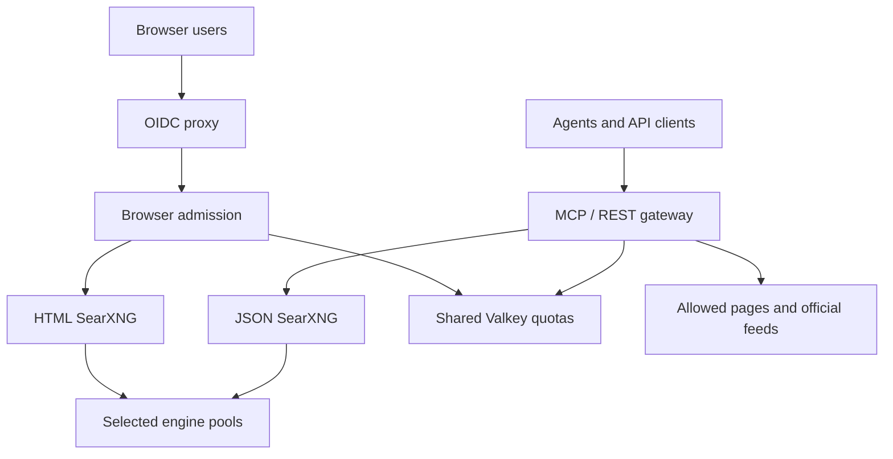

# SearXNG MCP Platform

Authenticated web search for agents, applications, and an optional SSO browser
interface. The repository contains the TypeScript MCP/API runtime, a complete
Helm workload chart, declarative Flux delivery, Ansible bootstrap, engine and feed
policies, capacity profiles, and verification tooling.

The deployment targets an existing Kubernetes or K3s cluster using OCI images.
It needs CPU resources; it has no GPU requirement. The 3,000- and 5,000-user
profiles are **capacity plans that require qualification**, not measured user or
throughput guarantees. See [capacity](docs/capacity.md) and
[verification status](docs/verification.md).

## Two example configurations

| | [All engines](examples/values-all-engines.yaml) | [All engines with security controls](examples/values-all-engines-secure.yaml) |
| --- | --- | --- |
| Engine coverage | 261 source-classified public candidates from a pinned 353-entry inventory (81 without an upstream-disabled flag, 180 with it) | Identical catalog and engine pools |
| Search fan-out | At most four engines per attempt; at most two alternate pools | Same bounds |
| Agent identity | Fixed configured fetch User-Agent and operator contact; native SearXNG suffix where supported | Same identification |
| Block handling | Alternate search pools and explicit official feed/API rules | Same alternatives, tighter fetch limits |
| MCP | Authenticated, scoped keys | Authenticated, scoped keys |
| REST API | Disabled; configurable | Enabled; requires `api:search` scope |
| Browser | Disabled | OIDC, group restriction, authenticated per-user quotas |
| Deployment shape | Combine with lab, 3k, or 5k capacity values | Complete 5k profile: three replicas per application component, HA store required |
| Ingress and monitoring | Opt in through site values | TLS ingress, ServiceMonitor, alerts, namespace quota enabled |

Both examples use non-root containers, read-only root filesystems, scoped
authentication, default-deny NetworkPolicies, request limits, and protected
backend services. The broader example is suitable for evaluation without
requiring an identity provider. It does not enable anonymous machine access.

"All engines" means the full upstream inventory is accounted for. Of the 261
`public_online` candidates, 81 are not marked upstream-disabled and 180 are.
That split is source metadata from the pinned catalog, not a measurement that
those providers answered or accepted this deployment. Engines requiring API
keys, local endpoints, Tor, or upstream repairs remain cataloged with their
prerequisites; they are not fabricated into working public services. The
[engine catalog guide](docs/engine-catalog.md) explains activation and source
verification. Provider availability, permissions, and quotas still apply.

## Request paths



The native JSON backend is private. Disabling the REST API also leaves the
browser backend HTML-only. Machine and browser searches share the same
deployment-wide admission budget, including each alternate engine attempt.
Adding gateway replicas does not multiply this budget.

The browser guard uses identity injected by the authenticated OIDC proxy and
hashes it for per-user quota keys. Native IP bot heuristics are disabled because
they would see a shared proxy address. The chart enforces the proxy's header
stripping contract and limits access to the guard through NetworkPolicy.

## Start with a reviewable configuration

Install the verification toolchain using [development instructions](docs/development.md),
then run:

```bash
npm ci --ignore-scripts
make check
```

Prepare your site override from [the example](examples/site-values.yaml.example).
Provide the actual built application image repository and digest, existing
Secrets, HA Valkey endpoint CIDRs, public DNS names, TLS certificate reference,
OIDC settings, and real service contact URL. Required deployment values are left
unset deliberately; the hardened example fails rendering until they are supplied.

For a machine deployment with the 3k capacity plan:

```bash
mkdir -p artifacts
helm template searxng-platform charts/searxng-platform --namespace searxng \
  -f environments/enterprise-3k.yaml \
  -f examples/values-all-engines.yaml \
  -f site-values.local.yaml > artifacts/rendered.yaml
```

For the complete hardened 5k plan:

```bash
helm template searxng-platform charts/searxng-platform --namespace searxng \
  -f examples/values-all-engines-secure.yaml \
  -f site-values.local.yaml > artifacts/rendered.yaml
```

Rendering makes no cluster changes. Follow [operations](docs/operations.md) to
build and identify the actual OCI artifact, prepare a source-pinned Flux bundle,
review a suspended deployment, qualify it, and promote it. Ansible reconciles
only the dedicated application namespace and Flux delivery objects; Flux owns
the Helm release. No cluster, IdP, or HA datastore is provisioned implicitly.

## Interfaces and credentials

| Interface | Route | Required grant |
| --- | --- | --- |
| MCP Streamable HTTP | `POST /mcp` | `mcp:search` and/or `mcp:fetch`, according to the tool |
| JSON search API | `GET` or `POST /api/v1/search` | `api:search`; API must be enabled |
| Human search | Separate HTTPS host | OIDC identity, configured domain/group policy |
| Readiness, liveness, metrics | Internal service only | Restricted by network policy; not published in Ingress |

Issue a separate key for each integration:

```bash
python3 scripts/create_principal.py \
  --manifest .secrets/principals.json \
  --token-file .secrets/research-agent.token \
  --id research-agent \
  --scopes mcp:search,mcp:fetch,api:search \
  --rate-limit 120
```

The token is written to a private file, never printed. Only its SHA-256 digest,
identifier, scopes, quota, and optional expiry enter the principal manifest.
Deploy that manifest through the existing Secret workflow. See
[API and authentication](docs/api.md) for requests, limits, expiry, and rotation.

The five search tools are `web_search`, `news_search`, `image_search`,
`video_search`, and `science_search`. Scoped fetch support adds `fetch_url`,
`fetch_batch`, `fetch_pdf`, `extract_article`, `search_and_extract`, and
`reddit_fetch`. Fetch tools require explicit allowed domains and do not imply
access to blocked, private, or authenticated content.

## Capacity starting points

| Population assumption | Sustained search-attempt budget | Minimum machine replicas | SearXNG blocking threads per pod |
| --- | ---: | --- | ---: |
| 3,000 users | 20/s | 3 gateways + 3 JSON backends | 16 |
| 5,000 users | 25/s | 3 gateways + 3 JSON backends | 32 |

The model assumes 20 searches per person per day over eight active hours, with
10% of users searching once every 30 seconds at a busy point and a five-QPS
machine reserve. Browser/OIDC workloads add separately specified resources.
Fallback attempts consume the budget, so heavily blocked engines reduce the
number of new user queries that can be admitted. A separate 50-QPS synthetic
burst scenario is supplied for qualification; it is not the production default.

Run `python3 scripts/capacity.py` to change the assumptions. Node loss, resource
requests at maximum HPA scale, upstream limits, extraction cost, and egress
reputation must all be measured before sizing a production installation.

## Configuration and release boundary

- [Chart control reference](charts/searxng-platform/CONFIGURATION.md): upstream settings, runtime controls, security boundaries, networking, secrets, scheduling, and monitoring.
- [Engine inventory](docs/engine-catalog.md): all configured engines, additional adapters, prerequisites, bounded pools, and header limitations.
- [API contract](docs/api.md): scoped keys, MCP/REST requests, fallback provenance, and quotas.
- [Operations](docs/operations.md): build, secrets, delivery, migration, rollback, and runtime qualification.
- [Security model](SECURITY.md): authentication, public-network fetching, privacy, and reporting.
- [Public release boundary](docs/publication-boundary.md): clean history, privacy scan, independent review, licensing, and publication procedure.

Upstream SearXNG is pinned to an immutable source revision and container digest.
Its engine adapters retain their upstream transport behavior; some override the
global User-Agent suffix. The direct fetcher guarantees a stable configured
identity. There is no browser impersonation rotation, CAPTCHA solving, or claim
that transparent headers eliminate Cloudflare blocks.

Licensed under the [MIT License](LICENSE). This project is independent and is not
affiliated with or endorsed by the SearXNG project. Third-party components, including
the separately distributed AGPL-3.0 SearXNG service, retain their own licenses
and attribution; see [NOTICE](NOTICE).
